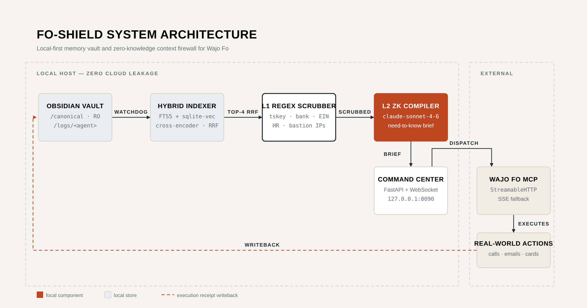
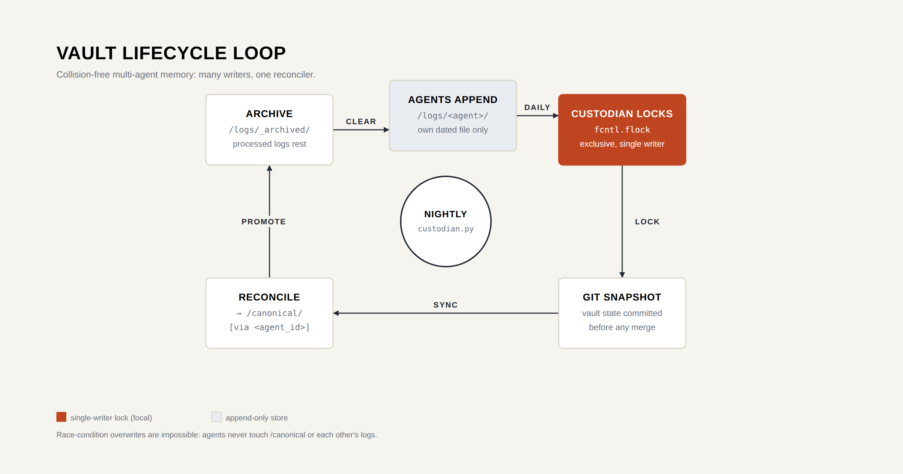
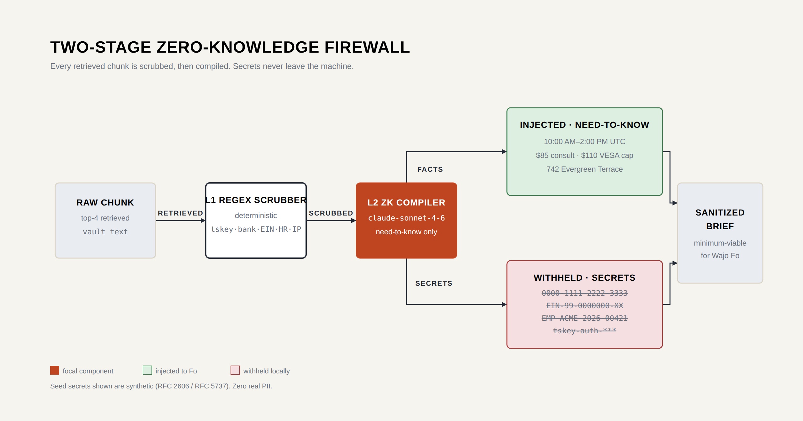

# 🛡️ Fo-Shield: Local Memory Vault & Zero-Knowledge Brief Compiler for Wajo Fo

[](https://modelcontextprotocol.io)
[](https://anthropic.com)
[](#architecture)
[](LICENSE)

> **Built for Wajo's "The GSD (Get s\*\*\* done!) Hackathon" (Supported by Anthropic)**
> *Give Wajo Fo complete memory of your preferences, budgets, and projects—without ever uploading your private life to the cloud or leaking sensitive PII to human assistants.*


---

## ⚡ The Problem: The Ephemeral Context Paradox

1. **Multi-Agent Memory Lock-In & Corruption**: Developers operate across half a dozen agents (`Grok Bot`, `Meta Muse`, `ChatGPT Dots`, `Claude Code`, `Hermes`). Storing memory inside one vendor locks you in. Moving memory into a local Obsidian Markdown vault solves lock-in, but multiple agents editing shared files causes race-condition overwrites, and naive folder scanning fails without embeddings and reranking.
2. **Wajo Fo's Privacy-Induced Amnesia**: Wajo's **Fo** action agent executes real-world tasks (phone calls, vendor emails, bookings, single-use virtual card purchases). Fo wins on trust because it **refuses to index your private messages** and escalates complex tasks to paid human assistants who see only single-task details.
3. **The Vulnerability**: Because Fo holds no persistent database of your life, it starts every complex task functionally blind. To get Fo to execute a nuanced errand, users paste raw context into prompts—risking accidental leakage of corporate bank accounts, tax IDs, internal infrastructure IPs, or private HR/health records to cloud logs and human middlemen.

---

## 🛠️ The Solution: Fo-Shield

**Fo-Shield** bridges a **User-Owned Obsidian/Markdown Memory Vault** with a **Two-Stage Zero-Knowledge Context Firewall** sitting directly in front of **Wajo's Fo MCP Server**.

```mermaid
flowchart LR
    subgraph Local["Local Host / User-Owned Drive (Zero Cloud Leakage)"]
        V[("Obsidian Vault\n/canonical/*.md (RO)\n/logs/<agent>/*.md (Append)")]
        IDX["Hybrid Indexer\nsqlite-vec (384d) + FTS5\n+ Cross-Encoder Rerank"]
        L1["L1 Regex Scrubber\nStrips Keys, EINs, Accts, IPs"]
        L2["L2 ZK Compiler\nclaude-sonnet-4-6\nNeed-to-Know Extraction"]
        UI["Fo-Shield Command Center\nFastAPI + WebSocket Audit UI"]
    end

    subgraph Cloud["External Execution Layer"]
        FO["Wajo Fo MCP Server\nStreamableHTTP / SSE"]
        WORLD["Real-World Actions\nPhone Calls, Vendor Emails,\nSingle-Use Virtual Cards"]
    end

    V -->|Watchdog| IDX
    IDX -->|Top-4 RRF + Recency Chunks| L1
    L1 -->|Pre-Scrubbed Context| L2
    L2 -->|Injected Facts vs. Withheld Secrets| UI
    UI -->|Sanitized Minimum-Viable Brief| FO
    FO --> WORLD
    FO -->|Execution Receipt Writeback| V
```



[](docs/diagrams/architecture.html)

---

## ✨ Key Architectural Features

### 1. Collision-Free Multi-Agent Obsidian Vault (`/canonical` vs `/logs`)
* **Read-Only Canonical State (`/canonical/*.md`)**: Holds authoritative preferences, budgets, and project specs. No worker agent can overwrite these files during live execution.
* **Isolated Append-Only Agent Logs (`/logs/<agent_id>/YYYY-MM-DD.md`)**: Every agent (`hermes`, `claude_code`, `grokbot`, `chatgpt_dots`, `fo_agent`) writes exclusively to its own dated log file protected by OS-level `fcntl.flock` exclusive locks.
* **Single-Writer Nightly Custodian (`custodian.py`)**: A scheduled local job locks the vault, takes a Git snapshot, reconciles daily logs into `/canonical/*.md` with provenance tags (`[Updated: YYYY-MM-DD via <agent_id>]`), and archives processed logs to `/logs/_archived/`.


[](docs/diagrams/lifecycle.html)
### 2. Two-Stage Hybrid Search + Cross-Encoder Reranking (`indexer.py`)
* Keeps the binary index at `~/.local/share/memory-vault/index.sqlite` (outside cloud-synced folders to prevent SQLite WAL lock corruption).
* **Stage 1 (Candidate Generation)**: Combines SQLite `FTS5` (BM25 lexical search) and `sqlite-vec` (`BAAI/bge-small-en-v1.5` 384-d embeddings) via **Reciprocal Rank Fusion (RRF)**.
* **Stage 2 (Baked-in Reranking)**: Scores the top 25 RRF candidates using `cross-encoder/ms-marco-MiniLM-L-6-v2` combined with an exponential time-decay boost so fresh logs outrank stale notes.

### 3. Two-Stage Zero-Knowledge Context Firewall (`fo_shield_server.py`)
Whenever any agent or user writes `- [ ] #fo <task>` in any Markdown file:
* **L1 Deterministic Regex Guard**: Immediately redacts Tailscale keys (`tskey-*`), bank/card numbers, corporate EINs, employee IDs, and internal bastion IPs before context ever touches an LLM.
* **L2 Claude Sonnet 4.6 Brief Compiler**: Synthesizes a self-contained, minimum-viable brief for Fo while outputting a transparent audit trail of **Injected Need-to-Know Facts** (green pills) vs. **Withheld Secrets** (red shields). Runs without an API key in deterministic L1-only fallback mode.


[](docs/diagrams/firewall.html)
### 4. Dual-Transport Fo MCP Client & Closed-Loop Writeback
* Auto-negotiates MCP `StreamableHTTP` (`streamablehttp_client`) and falls back to `SSE` (`sse_client`), dynamically inspecting `inputSchema` properties on the remote Fo MCP server. Leave `FO_MCP_URL` blank to run in instant demo simulation mode.
* Once Fo completes the task, Fo-Shield atomically checks off `- [x] #fo [FO-SHIELD:<id>]` in the source Markdown file and appends the structured execution receipt to `/logs/fo_agent/YYYY-MM-DD.md`.

### 5. Zero-Trust Remote Agent Bridge (`oauth_gateway.py` + `vault_bridge.py`)
* `vault_bridge.py` exposes `memory_query`, `memory_append`, and `bridge_status` to remote cloud agents as a FastMCP server on `127.0.0.1:8443` with flock-isolated appends.
* `oauth_gateway.py` fronts it with **OAuth 2.1 + PKCE (`S256`, plain method forbidden)** and fail-closed startup checks.

---

## 🚀 Quickstart (Under 60 Seconds)

### 1. Clone & Install Dependencies
```bash
git clone https://github.com/theglitcharchitect/fo-shield.git
cd fo-shield
python3 -m venv .venv
source .venv/bin/activate
pip install -r requirements.txt
```

### 2. Configure Environment
```bash
cp .env.example .env
# Edit .env with your ANTHROPIC_API_KEY and Wajo FO_MCP_URL
export $(grep -v '^#' .env | xargs)
```

### 3. Seed Synthetic Enterprise Vault & Launch Command Center
```bash
python3 seed_vault.py
python3 fo_shield_server.py
```
Open **`http://127.0.0.1:8090`** in your browser.

### 4. Verify the Zero-Leak Guarantee
```bash
python3 verify_e2e.py
```
Runs 5 end-to-end checks (seed, index, L1/L2 compile, dispatch + writeback, OAuth spoof rejection) and proves zero PII leakage: bank, EIN, HR, tskey, and bastion IP from the seed vault never leave the machine.

---

## 🖥️ Live Demo Walkthrough (`http://127.0.0.1:8090`)

1. **Trigger**: `seed_vault.py` initializes `~/MemoryVault` with synthetic enterprise data (*Acme Labs Engineering Vault*) and a one-line commitment in `logs/hermes/2026-10-18.md`:
   ```markdown
   - [ ] #fo Book an ergonomic workspace assessment session for this week and order a VESA dual-monitor desk mount delivered to the receiving dock under budget.
   ```
2. **Local Retrieval**: `indexer.py` retrieves the top 4 chunks from `canonical/profile_and_prefs.md` and `canonical/workstation_and_wellness.md`.
3. **Zero-Knowledge Audit**:
   * **Injected to Fo (Green)**: Window `10:00 AM–2:00 PM UTC`, delivery address `742 Evergreen Terrace Suite 200 Concierge`, consultation cap `$85 USD`, VESA mount cap `$110 USD`.
   * **Blocked Locally (Red)**: Corporate bank account `#0000-1111-2222-3333`, tax ID `EIN-99-0000000-XX`, employee ID `EMP-ACME-2026-00421`, group policy key `ShieldPlan-GRP-00099-TEST-PRIVATE`.
4. **Dispatch & Writeback**: Click **Approve & Dispatch to Wajo Fo MCP**. Fo executes the task, checks off the box in Obsidian, and writes the receipt to `/logs/fo_agent/2026-10-18.md`.
## 📂 Repository Structure

```text
fo-shield/
├── fo_shield_server.py   # FastAPI + WebSocket Orchestrator, L1/L2 ZK Firewall & Dual-Transport Fo MCP Client
├── dashboard.html        # Real-time 3-Column Zero-Knowledge Audit Command Center UI
├── indexer.py            # SQLite FTS5 + sqlite-vec (384-d) + Cross-Encoder Reranker + Watchdog
├── vault_bridge.py       # FastMCP Server (memory_query, memory_append, bridge_status) with flock isolation
├── oauth_gateway.py      # Starlette OAuth 2.1 + PKCE (S256) Zero-Trust Gateway
├── custodian.py          # Single-writer nightly log compaction daemon + automated Git snapshots
├── seed_vault.py         # Zero-PII synthetic enterprise vault generator (RFC 2606 / RFC 5737 compliant)
├── verify_e2e.py         # End-to-end verification: 5 checks, zero-PII-leakage proof
├── requirements.txt      # Pinned Python dependencies (mcp pinned <2: v2 removed FastMCP)
├── .env.example          # Environment configuration template
├── .gitignore            # Secrets, venvs, and local SQLite indices never committed
└── LICENSE               # MIT License
```

---

## 📜 License
MIT License. Built for the Wajo GSD Hackathon.
